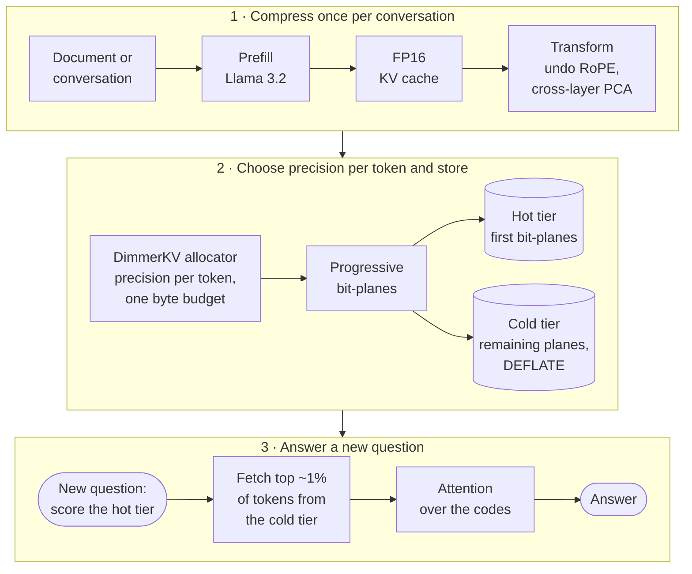

# DimmerKV: KV cache compression for LLM inference

**Dim the KV cache instead of deleting it.** DimmerKV compresses a language model's KV cache to
3–5% of its FP16 size (20–37× smaller) and still answers questions about the compressed text as well
as the uncompressed cache; at 2% (56× smaller) it keeps most answers. Instead of evicting tokens like H2O or SnapKV, it keeps **every token at a
precision chosen for that token**, sharpens the tokens a new question needs, and can run attention
directly over the compressed cache.

[](https://www.python.org/)
[](https://pytorch.org/)
[](https://github.com/huggingface/transformers)
[](https://huggingface.co/meta-llama)
[](#team)
[](LICENSE)

**Project page:** [srikanthbalaaji.github.io/Dimmer-KV](https://srikanthbalaaji.github.io/Dimmer-KV/) ·
**Full write-up:** [`docs/DimmerKV_overview.html`](docs/DimmerKV_overview.html) ·
**Every experiment:** [`FINDINGS.md`](FINDINGS.md)
· **Use it in vLLM or transformers:** [`PLUGIN.md`](PLUGIN.md)

| | |
|---|---|
| **37× smaller, full-cache accuracy** | 21/24 hidden facts recalled at 3% of FP16 KV memory, same as the uncompressed cache (Llama-3.2-1B, 8K tokens, question asked after compression) |
| **57× more conversations per GiB** | Llama-3.2-3B, 16K-token conversations, 18/18 answers correct |
| **0/36 for H2O** | Eviction deletes the facts a later question needs; DimmerKV keeps 36/36 at the same 2% budget (3B, 8K) |
| **8–14× less GPU memory while answering** | Attention runs over the compressed cache; the full FP16 cache never exists (2% budget, same answers) |

---

## Why

For every token an LLM reads, it stores a key and a value vector in every layer and attention head.
On Llama-3.2-3B that is about 112 KB per token, so one 16K-token conversation needs **1.75 GB**.
Servers that keep conversations between turns (chat assistants, agents, document Q&A, prefix
caching as in Mooncake) run out of memory fast, and re-reading a conversation from text is slow.

The usual fix is **KV cache eviction** (H2O, SnapKV): keep the tokens that received the most
attention and delete the rest. That fails when the question comes **after** compression. Before the
question exists, the facts it will need were never heavily attended: in our tests the hidden facts sat
at the 30–35th percentile of H2O's attention scores, so H2O deleted them.

## How it works



1. **Calibrate once per model** (kvtc-style transform coding). Undo RoPE on the keys, join all layers
   and heads into one vector per token, and fit one PCA basis on WikiText.
2. **Compress once per conversation.** The DimmerKV allocator measures each token's error at every
   precision step and spends one byte budget greedily by error removed per byte, from "dropped"
   (0 bytes) up to fine bit-planes. Every token first gets kvtc's uniform precision (a floor); the
   leftover bytes go to tokens the question attends to, when the question is known.
3. **Store in tiers.** Bit-pack and DEFLATE. A hot tier holds each token's first bit-planes, a cold
   tier the rest. Under memory pressure a conversation is demoted by dropping planes, with no
   re-encoding.
4. **Refine per question.** Score the coarse cache with the new question and fetch full precision
   for its top ~1% of tokens (0.5% extra bytes).
5. **Answer from the codes.** Keys are rebuilt one layer at a time and discarded; values stay in
   coefficient space (attention weights the coefficients, then applies the basis once per head).
   Answers match the fully decoded cache.

Today steps 3–4 run in the progressive mode (`prog@b:r0.01`), and the floor of step 2 and step 5 run
in the standard mode (`dkvtc@b:snap:floor1`); combining them is the next step.

## What is new

| | Eviction (H2O, SnapKV) | kvtc (ICLR 2026) | **DimmerKV** |
|---|---|---|---|
| Unit of decision | keep or delete a token | same precision for every token | **precision per token**, including 0 |
| Importance signal | attention before the question | none | **error per byte**, plus the question's attention when known |
| Question after compression | facts lost | uniform loss | **question-time refinement** fetches detail where the question looks |
| Coding | none | fixed bit allocation | **progressive bit-planes**: one encoding, any precision by truncation |
| Storage | single tier | single tier | **hot/cold tiers**, demote by dropping planes |
| Answering | normal cache | decode, then normal cache | **attention directly over the compressed cache** |

## Results at a glance

Llama-3.2-1B on an RTX 5060 laptop GPU (8 GB). Every question is asked **after** compression, and
every compressed method gets the same memory budget.

| Method | Memory per 8K-token chat | Facts asked later (needle, 3%) | Multi-hop tracking (RULER-style, 8K, 3%) | Exact lookup (RULER-style KV, 4K, 5%) | First answer token | GPU memory while answering |
|---|---|---|---|---|---|---|
| Full cache, uncompressed | 252 MiB | 21/24 | 0.96 | 0.65 | 48 ms | 253 MiB |
| Recompute from text | 0 | 21/24 | 0.96 | 0.65 | 1,267 ms | 253 MiB |
| H2O eviction | 3% | **0/24** | 0.11 | 0.00 | 35 ms | — |
| SnapKV eviction | 3% | **0/24** | 0.01 | 0.00 | — | — |
| kvtc transform coding | 3% | 19/24 | 0.81 | **0.70** | — | — |
| **DimmerKV (final setting)** | **3%, 6.8 MiB (37×)** | **21/24** | **0.90** | 0.65 | 437 ms | **41 MiB** |
| **DimmerKV progressive + refine** | 3% + 0.5% fetched | 20/24 | 0.88 | 0.55 | — | — |

Bigger model: on Llama-3.2-3B with 16K-token conversations (AWS L40S), DimmerKV at 2% answers
**18/18** and fits **57× more conversations per GiB**; H2O at 2% answers 0/18. "—" means not
measured in that setting.

<details>
<summary><b>Head to head on storage and speed: H2O, Lexico, DimmerKV</b> (1B, ~3.1K-token conversations)</summary>

| method | stored per conversation | smaller by | conversations in 8 GiB RAM | compress | restore | first answer token | tokens/s | correct | perplexity |
|---|---|---|---|---|---|---|---|---|---|
| Full cache in RAM | 96.3 MiB | 1× | 85 | — | 5 ms | 25 ms | 64 | 24/24 | 11.32 |
| Recompute from the text | ~0 | — | unlimited | — | 840 ms | 891 ms | 61 | 24/24 | 11.32 |
| H2O 5% | 4.9 MiB | 20× | 1,685 | 28 ms | <1 ms\* | 22 ms | 58 | 0/24 | 12.72 |
| H2O 10% | 9.7 MiB | 10× | 846 | 30 ms | <1 ms\* | 22 ms | 60 | 0/24 | 12.29 |
| Lexico 10% (uniform) | 9.2 MiB† | 10× | ~890† | 362 ms | ~30–45 ms‡ | — | — | 0/24 | 13.90 |
| **DimmerKV 3%** | **2.6 MiB** | **37×** | **3,127** | 348 ms | 154 ms | 176 ms | 61 | **23/24** | **11.58** |
| **DimmerKV 5%** | 4.3 MiB | 22× | 1,896 | 360 ms | 166 ms | 188 ms | 64 | **24/24** | **11.45** |

DimmerKV here is the question-unaware setting (`dkvtc@b`), sizes after bit-packing and DEFLATE.
\* H2O's restore only copies its kept tokens (simulated layout, a lower bound). † Counted from
Lexico's codes. ‡ From the codec benchmark. Sources: `results/memory_time_accuracy.csv`,
`results/serving.csv`.
</details>

<details>
<summary><b>Final setting vs the uncompressed cache</b> (1B, 8K tokens, question after compression)</summary>

| | full cache on GPU | full cache in RAM | recompute | **final 2%** | **final 3%** |
|---|---|---|---|---|---|
| stored per conversation | 252 MiB | 252 MiB | ~0 | 4.5 MiB (56×) | **6.8 MiB (37×)** |
| conversations in 8 GiB RAM | — | 32 | unlimited | 1,806 | **1,209** |
| compress (once) | — | — | — | 1.5 s | 2.5 s |
| time to first token | 42 ms | 48 ms | 1,267 ms | 310 ms | 437 ms |
| generation speed | 39–47 tok/s | 47 tok/s | 45 tok/s | 47 tok/s | 47 tok/s |
| correct / answer probability | 21/24 / .76 | 21/24 / .76 | 21/24 / .76 | 16/24 / .43 | **21/24 / .62** |

Answering directly over the codes at 3%: 41 MiB held per conversation instead of 253 MiB, peak extra
GPU memory 70 MiB instead of 506 MiB, at 29 instead of 46 tokens/s. Source: `results/serving_8k_final.csv`,
`results/grid_1b_ctx8000_final.csv`.
</details>

<details>
<summary><b>Question known before compression</b> (8K-token documents)</summary>

| method | 1B, 1.5% | 1B, 2% | 3B, 2% |
|---|---|---|---|
| Full cache (100%) | 21/24 | 21/24 | 36/36 · .992 |
| SnapKV (evict by question attention) | 6/24 | 10/24 | 34/36 · .913 |
| kvtc (same precision for all) | — | 17/24 | 35/36 · .978 |
| **DimmerKV, question scores (+ eviction level on 1B)** | **21/24** | **22/24** | **36/36 · .986** |
| **DimmerKV progressive + refinement** | — | — | **36/36 · .992** |
</details>

<details>
<summary><b>Serving: 3B model, 16K-token conversations</b></summary>

| how a conversation is kept | stored | conversations in 8 GiB RAM | first answer token | correct |
|---|---|---|---|---|
| Full cache in RAM | 1,753 MiB | 4 | 189 ms | 18/18 |
| Re-read the text (chunked SDPA prefill) | ~0 | unlimited | 1,434 ms | 18/18 |
| H2O, 2% | 35 MiB | 230 | 61 ms | **0/18** |
| **kvtc / DimmerKV, 2%** | **31 MiB** | **263 (57×)** | **488–627 ms** | **18/18** |
</details>

<details>
<summary><b>Answering directly from the compressed cache</b> (1B, 8K tokens)</summary>

| method | same answers as rebuilt cache | GPU memory held per conversation | tokens/s (rebuilt → direct) |
|---|---|---|---|
| kvtc 2% | 12/12 | 253 MB → **18 MB** | 45 → 41 |
| DimmerKV 2% | 12/12 | 253 MB → **22 MB** | 45 → 39 |
| DimmerKV + question scores + eviction 2% | 12/12 | 253 MB → **31 MB** | 31 → 31 |
| kvtc 5% | 12/12 | 253 MB → 55 MB | 43 → 29 |
</details>

<details>
<summary><b>RULER-style long-context tasks and perplexity</b></summary>

1B, 20 samples per cell:

| method | variable tracking 8K, 3%, question in prompt | variable tracking 8K, 2%, question later | key-value retrieval 4K, 5%, question later |
|---|---|---|---|
| Full cache | 0.96 | 0.96 | 0.65 |
| H2O | 0.15 | 0.02 | 0.00 |
| SnapKV | 0.34 | 0.00 | 0.00 |
| kvtc | 0.82 | 0.82 | **0.70** |
| DimmerKV + question scores + eviction | **0.92** | 0.84 | 0.40 |
| DimmerKV progressive + refine top 1% | 0.87 | **0.87** | 0.55 |
| **DimmerKV + question scores + floor at kvtc's level** | 0.91 | 0.90 at 3% (not run at 2%) | **0.65** |

Perplexity, 3B, 8K tokens (full cache 8.33, lower is better):

| method | 2% | 3% | 5% |
|---|---|---|---|
| H2O | 10.64 | 10.41 | 10.11 |
| SnapKV | 10.25 | 9.92 | 9.51 |
| kvtc | 8.48 | 8.42 | 8.34 |
| **DimmerKV, question scores** | **8.46** | **8.37** | 8.35 |
</details>

<details>
<summary><b>What each change bought</b></summary>

| change | before | after |
|---|---|---|
| Per-token allocation instead of uniform (Lexico, 15%, question later) | 5/18 | 10/18 |
| kvtc transform instead of Lexico (1B, 4%, question later) | 0/36 | 33–36/36 |
| Progressive bit-planes vs kvtc's bit ladder (reconstruction error, 1B) | — | 10–30% lower at equal size |
| Question-time refinement (1B, 8K, 2%, question later) | ans p .50 | ans p .71 (full .75) |
| Question scores + eviction level (1B, 8K, 1.5%, question known) | SnapKV 6/24 | 21/24 (= full cache) |
| Partial-basis decode (restore, 1B 8K / 3B 16K, 2%) | 390 ms / 1,597 ms | 93 ms / 416 ms |
| Attention over codes instead of a rebuilt cache (GPU memory while answering, 1B 8K, 2%) | 253 MB | 18–31 MB |
</details>

## Quickstart

```bash
git clone https://github.com/SrikanthBalaaji/Dimmer-KV.git
cd Dimmer-KV
python -m venv .venv
source .venv/bin/activate            # Windows: .venv\Scripts\activate
# Install the PyTorch build for your GPU first: https://pytorch.org/get-started/locally/
pip install -r requirements.txt
hf auth login                        # Llama 3.2 is gated on Hugging Face

python scripts/fit_kvtc.py           # one-time calibration, ~1.3 min on 1B
python scripts/fit_progressive.py    # progressive bit-plane order
python scripts/demo_app.py           # Gradio demo at http://127.0.0.1:7860
```

Tested on Windows (RTX 5060 laptop, 8 GB) with Llama-3.2-1B-Instruct and on Linux (AWS L40S) with
Llama-3.2-3B-Instruct. Checkpoints are not in git; refit them per model.

**Reproduce the main results**

```bash
# Question asked after compression: kvtc vs progressive refinement vs H2O
python scripts/test_generation.py --context-tokens 8000 --configs kvtcf@0.02 prog@0.02:r0.01 h2o:0.02
# Question in the prompt: SnapKV vs DimmerKV with question scores and an eviction level
python scripts/test_generation.py --mode prompt --context-tokens 8000 --configs h2o:0.02:snap dkvtc@0.02:snap:ev
# RULER-style tasks with the recommended setting
python scripts/eval_ruler.py --task vt --context-tokens 8000 --configs kvtcf@0.03 dkvtc@0.03:snap:floor1 h2o:0.03
python scripts/eval_ruler.py --task kv --context-tokens 4000 --configs kvtcf@0.05 dkvtc@0.05:snap:floor1
# Perplexity, serving, and attention over the compressed cache
python scripts/eval_perplexity.py --configs kvtcf@0.03 dkvtc@0.03:snap h2o:0.03
python scripts/bench_serving.py --context-tokens 8000 --methods h2o:0.02 kvtcf@0.02 dkvtc@0.02
python scripts/test_compressed_attention.py --context-tokens 8000 --methods kvtcf@0.02 dkvtc@0.02
```

Method names (`h2o:0.02`, `kvtcf@0.03`, `dkvtc@0.02:snap:floor1`, `prog@0.02:r0.01`, …) are
documented at the top of [`scripts/methods.py`](scripts/methods.py). The recommended setting is
`dkvtc@<budget>:snap:floor1`.

## Repository layout

| path | what it is |
|---|---|
| `scripts/kvtc.py`, `fit_kvtc.py` | transform coding (RoPE removal, cross-layer PCA, grouped quantization), DimmerKV per-token allocation, eviction level |
| `scripts/progressive.py`, `fit_progressive.py` | progressive bit-planes, hot/cold tiers, question-time refinement |
| `scripts/kvtc_storage.py` | real byte storage (bit-packing, DEFLATE) and partial-basis restore |
| `scripts/compressed_attention.py` | attention directly over the compressed cache |
| `scripts/dimmer.py` | attention hook: H2O and question-window scores, eviction masks, chunked prefill |
| `scripts/methods.py` | one name per method, shared by every script and the demo |
| `scripts/test_generation.py`, `eval_ruler.py`, `eval_perplexity.py`, `bench_serving.py`, `run_grid.py` | needle tests, RULER-style tasks, perplexity, serving benchmark, CSV grid runner |
| `scripts/demo_app.py`, `demo_backup.py` | Gradio demo and its static backup |
| `scripts/lexico.py`, `pca_codec.py` | earlier codecs (Lexico sparse coding, per-head PCA), kept as ablations |
| `docs/` | project page, overview with the architecture diagram, recorded demo |
| `FINDINGS.md`, `results/` | every experiment, and the raw result files |

## Limits

- **Small samples**: 18–36 needle questions or 20 RULER samples per setting, so differences of 1–2
  answers (about 0.1 on RULER) are noise. Most runs use Llama-3.2-1B; 3B is a check; 8B and
  LongBench are not done.
- **Without the question, per-token precision is only slightly better than kvtc** (often tied at 8K
  tokens). The clear gains come from question scores and question-time refinement.
- **Dense lookups favour uniform precision**: on RULER-style key-value retrieval kvtc scores
  0.65–0.70 at 5%; DimmerKV needs the floor at kvtc's level to tie it (0.65).
- **Latency**: restoring a compressed chat (0.3–0.4 s on 8K tokens) is about 3× faster than
  recomputing but slower than copying an uncompressed cache from RAM (48 ms). Answering directly over
  the codes runs at 0.5–0.9× the speed of a rebuilt cache; the rebuild path itself needs about 1.6 GiB
  of temporary GPU memory at 8K tokens (0.6 GiB for the uncompressed cache).
- **At 2% the floor cannot act** (kvtc only affords its coarsest step), so the final setting scores
  16/24 vs kvtc's 17/24 there; refinement is the better 2% option (19/24).
- **21/24 is the 1B model's own ceiling at 8K tokens**: the uncompressed cache, and plain Hugging Face
  generation without any of our code, miss the same 3 questions (all the same needle).
- **Our kvtc is simplified** (greedy bit allocation, fixed groups of 64, zlib on the CPU); the numbers
  are ours, not a reproduction of the paper. Question-time refinement counts its fetch but the cold
  tier is not yet on a separate device.

## License

[MIT](LICENSE) © 2026 Srikanth Balaaji, Sushanth B, T S Sathya Kiran. The license covers our code. The
methods we build on (kvtc, H2O, SnapKV, Lexico) belong to their authors and are credited below; Llama
3.2 weights are under Meta's Llama 3.2 Community License and are not part of this repository.

## Citation

If DimmerKV is useful in your work, please cite it (GitHub's "Cite this repository" button uses
[`CITATION.cff`](CITATION.cff)):

```bibtex
@software{dimmerkv2026,
  title  = {DimmerKV: Per-Token Precision for KV Cache Compression in LLM Inference},
  author = {Balaaji, Srikanth and B, Sushanth and Kiran, T S Sathya},
  year   = {2026},
  url    = {https://github.com/SrikanthBalaaji/Dimmer-KV}
}
```

## Credits

- **kvtc**: Staniszewski & Łańcucki, *KV Cache Transform Coding for Compact Storage in LLM
  Inference*, ICLR 2026. Cross-layer PCA, RoPE removal and grouped quantization come from this paper.
- **H2O** (Zhang et al., NeurIPS 2023) and **SnapKV**: eviction baselines and the attention-score
  ideas behind our importance weights.
- **Lexico** (Kim et al., ICML 2025): sparse dictionary coding of KV vectors; our first codec and an
  ablation.
- **Loki** and **Mooncake**: score-then-fetch and tiered KV storage, which shaped question-time
  refinement and the hot/cold tiers.

## Team

Built in 24 hours at **Hashcode 14.0** (Track 01, LLM Inference, PES University, October 2026) by
**Team Deadoop**: Srikanth Balaaji, Sushanth B, T S Sathya Kiran.
